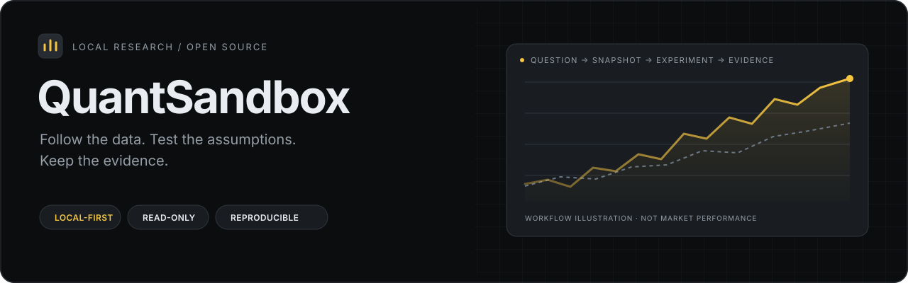

<p align="center">
  
</p>

<h1 align="center">QuantSandbox</h1>
<p align="center"><strong>Investment research you can trace, test, and reproduce.</strong></p>
<p align="center">A local-first workbench for company research, industry cycles, statistics, and strategy backtesting.</p>

<p align="center">
  <a href="https://github.com/tail258/QuantSandbox/actions/workflows/check.yml"></a>
  <a href="LICENSE"></a>
  
  
  
</p>

<p align="center">
  <strong>English</strong> · <a href="README.zh-CN.md">简体中文</a><br />
  <a href="#quick-start">Quick start</a> · <a href="#reproduce-an-experiment">Reproduce an experiment</a> · <a href="CONTRIBUTING.md">Contribute</a> · <a href="https://github.com/tail258/QuantSandbox/releases">Releases</a>
</p>

---

## One workspace, from question to evidence

QuantSandbox connects a research question to its data, assumptions, experiments, and saved conclusions. The browser, CLI, and API share the same Python calculations. Data and research records stay in your local workspace; public market data is fetched only when requested.

<table>
  <tr>
    <td width="50%"><strong>01 · Research</strong><br />Compare quarterly financials and peers using company-specific templates. Track industry indicators, ETF flows, and disclosed institutional holdings.</td>
    <td width="50%"><strong>02 · Test</strong><br />Explore correlation, lags, and conditional probabilities. Inspect execution, fees, cash, and positions through backtests and historical replay.</td>
  </tr>
  <tr>
    <td><strong>03 · Reproduce</strong><br />Keep fixed snapshots, saved parameters, source metadata, and execution fingerprints. Export an evidence bundle and recompute it.</td>
    <td><strong>04 · Keep your workflow</strong><br />English or Chinese. Classic light or Financial terminal. Download Markdown, SVG charts, and attachments; Obsidian integration is optional.</td>
  </tr>
</table>

The workbench focuses on mainland China's A-share market. It includes rubber-industry observations and four built-in strategies: moving-average crossover, Bollinger bands, RSI reversal, and momentum. Experiments include historical forks, cost stress, parameter sensitivity, rolling out-of-sample evaluation, and blind replay.

## US company research · initial scope

A separate US research module starts with **McDonald’s (NYSE: MCD)**: explicitly refresh public SEC annual financial facts and filing references, import USD unadjusted daily OHLCV CSV with a source URL, and save research evidence to a local project. English/Chinese UI is supported. US prices do not enter the A-share backtest engine. SEC access needs a user-configured identifying User-Agent; no paid data subscription is required for SEC data or manual imports. See the [US research guide](docs/us-equities.md) for setup, provenance and limits.

## Quick start

**Windows:** Python **3.12+**, Node.js **22.12+**, and PowerShell **7+**. Python 3.12 and Node 22 are used by CI. Installation needs internet access for dependencies; the synthetic example runs offline after installation.

```powershell
git clone https://github.com/tail258/QuantSandbox.git
Set-Location QuantSandbox
.\setup.cmd
.\start.cmd
```

Open **http://127.0.0.1:8766**. The service listens on your computer only. On later visits, run `start.cmd`; stop this workspace with `pwsh -NoProfile -File stop.ps1`.

The interface starts in **English**. Use the top-bar language and **Appearance** selectors to switch to Chinese or the dark Financial terminal theme. Preferences stay in the current browser. Company names, user notes, source documents, and archived evidence retain their original text.

<details>
<summary><strong>Manual setup, including Linux/macOS</strong></summary>

The backend and frontend are tested on Linux; the convenience launchers target Windows. From the repository root, create and activate a Python virtual environment using your platform's commands, then run:

```sh
python -m pip install -r requirements-dev.txt -c requirements-lock.txt
npm ci --prefix frontend
npm run build --prefix frontend
python -m uvicorn backend.main:app --host 127.0.0.1 --port 8766
```

For production-only Python dependencies, use `requirements.txt`; add `requirements-market.txt` for live providers. The offline reproduction tool requires the development dependencies. The lock file constrains Python dependency versions, and `npm ci` uses the committed package lock.

</details>

## Reproduce an experiment

Run a complete synthetic example without starting a server or downloading market data:

```powershell
.\.venv\Scripts\python.exe -X utf8 scripts/reproduce.py
```

The command creates isolated temporary stores, runs a backtest, exports its evidence, imports the original JSON into a second store, and verifies the replay against fixed expectations. It exits with a failure if verification fails. To retain the generated example in a new, empty directory:

```powershell
.\.venv\Scripts\python.exe -X utf8 scripts/reproduce.py --output exports/repro-demo
```

This example is explicitly synthetic. Your existing datasets, research projects, and notes are not used. See the [reproducibility guide](docs/reproducibility.md) for the fixture, checks, and tagged-release instructions, and the [release guide](docs/releases.md) for archive checksums and rebuilding from source.

## A practical research loop

1. **Choose a question.** Create a project and select its securities, company template, peers, and research focus.
2. **Check the inputs.** Reuse cached data or fetch/import a snapshot. Read each series' actual coverage, source, unit, reporting period, and availability date.
3. **Compare and test.** Analyze quarterly financials and industry series, then bridge a specific unadjusted-price snapshot into strategy experiments.
4. **Inspect the path.** Review signals, next-session execution, fees, positions, and the account ledger. Compare alternative assumptions on the same inputs.
5. **Save the evidence.** Link analyses and experiments to the project, save a conclusion, and choose what to export.

## Data and calculation boundaries

| Topic | What the workbench preserves |
| --- | --- |
| Missing data | Missing values remain missing. Provider failures stay visible; live-data failures never silently become synthetic prices. |
| Financial statements | Income and cash-flow cumulative amounts are split into quarters; balance-sheet balances are not differenced. Ratios are recomputed. Currently revised statements are not a complete historical point-in-time archive. |
| Statistics | Transform, alignment, frequency, lag direction, sample count, baseline, and interval accompany the result. Correlation and repeated parameter searches need separate validation. |
| Execution | Daily closing signals execute no earlier than the next tradable session's open. Explicit suspension and price-limit fields survive snapshots and replay. Corporate actions and complete delisting returns are not yet booked. |
| Market proxies | ETF subscriptions/redemptions and margin data cannot identify a specific trading entity. State-backed holdings require original disclosure evidence. RU0 is a vendor continuous series, not a directly tradable total-return contract. |
| Evidence | Content hashes check integrity. Import replays the saved inputs with the current engine and reports differences. A hash is not third-party certification. |

Method details: [backtesting](docs/RESEARCH_NOTES.md) · [financials and statistics](docs/methodology.md) · [ETF flows](docs/etf-methodology.md) · [institutional disclosures](docs/national-methodology.md). These detailed methodology documents are currently in Chinese; the [API contract](docs/API_CONTRACT.md), [architecture](docs/ARCHITECTURE.md), and reproduction guide are in English.

## Local data and optional notes

The strategy store lives under `data/`; company research uses `data/workbench/`. Local data, exports, attachments, company profiles, environment settings, dependencies, and build output are excluded from Git and release packages. Back up `data/` and `exports/` separately when the service is stopped.

Markdown and attachment downloads work without a notebook configuration. Direct Obsidian writing is an explicit, previewed action that creates new files and refuses to overwrite existing notes. There is no vault scan, background sync, or scheduled publishing. See the [integration contract](docs/obsidian.md) (Chinese).

## Develop and contribute

```powershell
pwsh -NoProfile -File scripts/dev.ps1
pwsh -NoProfile -File scripts/check.ps1
```

Development uses frontend port **5174** and API port **8000**. Production uses **8766**. Interactive API documentation is at `/docs`; the research CLI starts with `python -m backend.workbench.cli status`.

Start with [CONTRIBUTING.md](CONTRIBUTING.md). Report a reproducible problem using the [bug form](https://github.com/tail258/QuantSandbox/issues/new?template=bug_report.yml), propose an improvement using the [feature form](https://github.com/tail258/QuantSandbox/issues/new?template=feature_request.yml), and follow [SECURITY.md](SECURITY.md) for sensitive reports. The [roadmap](docs/ROADMAP.md) separates current capabilities from planned work. Changes are recorded in the [changelog](CHANGELOG.md).

Licensed under [MIT](LICENSE). Market-data providers have their own terms; the software license does not grant redistribution rights to third-party datasets.
