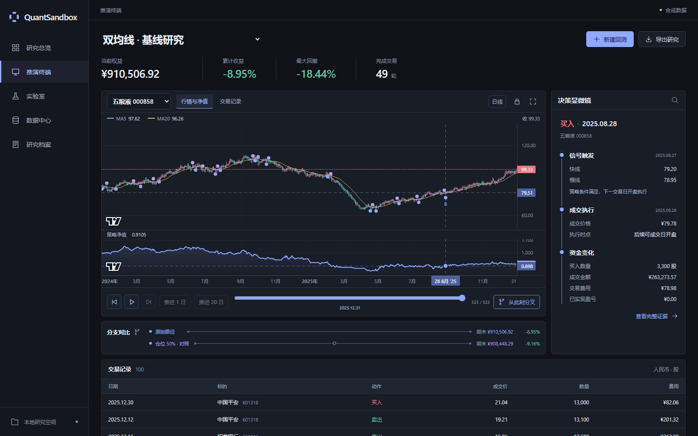

<p align="center">
  
</p>

<p align="center">
  <a href="https://github.com/tail258/QuantSandbox/actions/workflows/check.yml"></a>
  
  
  <a href="LICENSE"></a>
</p>

<p align="center">
  在同一份行情上，理解交易、比较选择、重放研究。
</p>

<p align="center">
  <a href="#快速开始">快速开始</a> ·
  <a href="#研究能力">研究能力</a> ·
  <a href="docs/ARCHITECTURE.md">架构文档</a> ·
  <a href="docs/API_CONTRACT.md">API 契约</a> ·
  <a href="docs/ROADMAP.md">后续方向</a>
</p>

---

QuantSandbox 将 **共享资金回测 → 成交解释 → 历史分叉 → 稳健性实验 → 证据归档** 串成完整的本地研究流程。选择策略与行情，在时间轴上查看每一次决策，再用可复现的对照检验想法。

<p align="center">
  
  <br />
  <sub>研究终端 · 图表与成交证据联动 · 截图使用合成演示行情</sub>
</p>

## 研究能力

<table>
  <tr>
    <td width="50%" valign="top">
      <h3>策略回测</h3>
      <p>多标的共享资金，记录现金、持仓与交易成本。内置双均线、布林带、RSI 和动量策略。</p>
    </td>
    <td width="50%" valign="top">
      <h3>成交解释</h3>
      <p>从成交回看信号日期、指标、执行价格和费用，理解每笔交易如何发生。</p>
    </td>
  </tr>
  <tr>
    <td valign="top">
      <h3>历史分叉</h3>
      <p>在某日收盘后改变策略或仓位，复用原始行情快照，对照后续路径。</p>
    </td>
    <td valign="top">
      <h3>稳健性实验</h3>
      <p>比较费用、滑点、延迟和仓位情景，运行参数敏感性与滚动样本外验证。</p>
    </td>
  </tr>
  <tr>
    <td valign="top">
      <h3>逐日推演</h3>
      <p>沿时间轴推进与复盘；盲测模式仅展示当前游标之前的行情、成交和指标。</p>
    </td>
    <td valign="top">
      <h3>证据重放</h3>
      <p>将配置、数据快照、账本与结果一起导出，导入后重新计算并核对差异。</p>
    </td>
  </tr>
</table>

## 快速开始

**环境**　Python 3.12+ · Node.js 22.12+ · Windows 脚本使用 PowerShell 7

```powershell
git clone https://github.com/tail258/QuantSandbox.git
cd QuantSandbox
pwsh -File scripts/setup.ps1
pwsh -File scripts/dev.ps1
```

打开 **[localhost:5173](http://localhost:5173)**，点击「运行合成数据示例」体验完整流程，或通过「新建回测」配置研究。首次启动保留空研究空间，合成行情可离线运行。

<details>
<summary><b>macOS / Linux 启动方式</b></summary>

```bash
python3 -m venv .venv
.venv/bin/python -m pip install -r requirements-dev.txt -c requirements-lock.txt
npm ci --prefix frontend
.venv/bin/python -m uvicorn backend.main:app --host 127.0.0.1 --port 8000
```

在另一个终端启动前端：

```bash
npm run dev --prefix frontend -- --host 127.0.0.1
```

</details>

<details>
<summary><b>接入真实行情</b></summary>

Windows 安装可选依赖：

```powershell
pwsh -File scripts/setup.ps1 -MarketData
```

其他系统：

```bash
.venv/bin/python -m pip install -r requirements-market.txt -c requirements-lock.txt
```

创建回测时选择 **AKShare**。行情请求依赖外部服务和本机网络；请求失败会明确报错，数据中心可检查实际使用的快照。

</details>

<details>
<summary><b>端口、数据目录与停止服务</b></summary>

按 `Ctrl+C` 停止脚本启动的前后端及计算进程。指定其他端口：

```powershell
pwsh -File scripts/dev.ps1 -ApiPort 8001 -WebPort 5174
```

| 设置 | 默认值 | 配置方式 |
| --- | --- | --- |
| 研究数据目录 | `data/` | `QUANT_SANDBOX_DATA_DIR` |
| 前端开发代理的 API 端口 | `8000` | `QUANT_API_PORT` |
| 访问范围 | 本机回环地址 | 本地单用户运行 |

进程中断的活动任务会标记为失败，可重新提交；已完成研究和数据快照保留。

</details>

## 从想法到证据

| 步骤 | 在工作台中做什么 |
| :--- | :--- |
| **01 · 建立基线** | 设置日期、股票池、策略参数、资金和交易成本 |
| **02 · 核对交易** | 联动查看 K 线、成交账本与决策证据 |
| **03 · 创建对照** | 在历史时点分叉，或从基线发起实验 |
| **04 · 保存结论** | 记录笔记、导出证据包，之后导入重算 |

研究总览管理任务，推演终端查看交易，实验室比较结果，数据中心核对来源，研究档案保存笔记与证据。研究指令使用本地规则解析为配置草稿。

## 技术与开发

| 层次 | 技术 | 职责 |
| --- | --- | --- |
| 工作台 | Vue · TypeScript · Vite · Lightweight Charts | 图表、研究交互与回放 |
| 服务 | FastAPI · 独立计算进程 | 请求校验、研究用例与任务调度 |
| 内核 | Python · Pandas | 策略、撮合、账户与指标 |
| 存储 | SQLite · Parquet | 研究档案与行情快照 |

模块化单体，计算任务串行执行并支持取消。接口、研究服务、回测内核和数据访问分别维护职责。参见 **[架构与扩展约定](docs/ARCHITECTURE.md)**。

```powershell
# 后端测试 + 前端状态测试 + 类型检查 + 生产构建
pwsh -File scripts/check.ps1
```

<details>
<summary><b>单独运行检查与性能基准</b></summary>

```powershell
./.venv/Scripts/python.exe -m pytest -q
npm test --prefix frontend
npm run build --prefix frontend
./.venv/Scripts/python.exe scripts/benchmark.py --symbols 100
```

macOS / Linux 使用 `.venv/bin/python`。内核基准基于合成行情，不含下载、磁盘和进程启动。

测试覆盖信号因果性、账户守恒、分叉历史一致性、盲测截断、缓存、证据重放、进程取消、响应契约和前端请求竞态。CI 在 Windows / Linux 上执行后端测试，并执行前端测试与构建。

</details>

## 研究口径

日线模型采用收盘信号、后续可交易日开盘执行，默认整手、T+1 与固定交易成本。真实行情当前为未复权价格，尚未记账公司行为或模拟盘口与市场冲击；参数最优值来自同区间比较。

完整的账户规则、合成数据范围、样本外设计和证据校验说明，见 **[计算与数据口径](docs/RESEARCH_NOTES.md)**。

---

<p align="center">
  <a href="docs/ARCHITECTURE.md">架构</a> ·
  <a href="docs/API_CONTRACT.md">接口</a> ·
  <a href="docs/RESEARCH_NOTES.md">研究口径</a> ·
  <a href="docs/design/SPEC.md">视觉规范</a> ·
  <a href="LICENSE">MIT License</a>
  <br />
  <sub>QuantSandbox · 量化研究与教学</sub>
</p>
