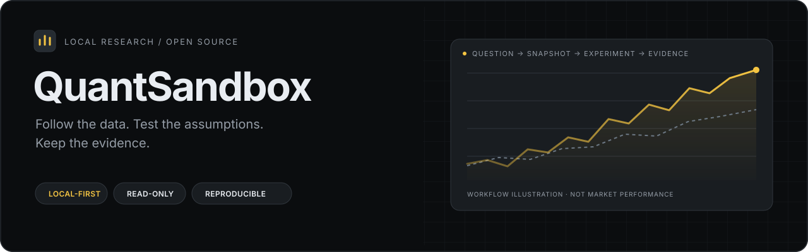

<p align="center"></p>
<h1 align="center">QuantSandbox</h1>
<p align="center"><strong>本地投资研究与量化分析工作台</strong></p>
<p align="center"><a href="README.md">English</a> · <strong>简体中文</strong> · <a href="CONTRIBUTING.md">参与贡献</a> · <a href="https://github.com/tail258/QuantSandbox/releases">下载发布</a></p>
<p align="center"><a href="https://github.com/tail258/QuantSandbox/actions/workflows/check.yml"></a> <a href="LICENSE"></a> </p>

在同一个本地工作台完成公司研究、产业观察、统计分析与策略验证。浏览器用于交互，Python 负责数据、计算和证据；Codex 可通过 CLI 与 API 调用同一套逻辑。市场操作只读，没有券商连接或实盘下单。

## 打开与安装

已有环境双击 `start.cmd`，打开 **http://127.0.0.1:8766**。只监听本机；不会自动刷新行情、设置定时任务或写入笔记库。

界面默认英文，可在顶部切换 English / 中文。主题提供原有经典浅色与黑灰金色的金融终端主题；语言和主题选择保存在当前浏览器，刷新后保留。切换只影响界面展示，研究原文、用户输入和归档证据保留原样。

```powershell
git clone https://github.com/tail258/QuantSandbox.git
Set-Location QuantSandbox
.\setup.cmd
.\start.cmd
```

Windows 需要 Python 3.12+、Node.js 22.12+ 和 PowerShell 7。安装包括公开行情依赖与前端构建；生产运行只需要 Python。停止：`pwsh -NoProfile -File stop.ps1`。Codex 启动使用 `pwsh -NoProfile -File start.ps1 -NoBrowser`。

## 页面与研究流程

导航按研究、市场观察、验证、数据与归档组织导航。首页采用项目列表与当前详情并排的布局，提供概览、证据、实验和结论；创建项目按需打开。当前项目贯穿页面，已保存的公司比较、统计和策略实验保留项目关联。

财务和统计优先展示结果，参数及公司配置按需展开。策略终端联动行情与成交证据，账本和决策分栏查看；实验室先展示已有结果，再创建对照。手机采用研究、市场、验证、更多四类入口。

Obsidian 默认显示排版笔记，可切换 Markdown 源码；本机路径设置按需打开。

### 从观察到归档

1. 在数据中心获取行情、财报或公告，检查来源、实际截止日与口径。
2. 按公司配置比较单季度财务，观察产业指标或 ETF 资金，保存统计分析。
3. 新建研究项目，关联研究问题和分析记录；将固定的未复权股票行情送入策略实验。
4. 在策略实验中核对资金、成交与信号，创建历史分叉，检验费用、参数和滚动样本外表现。
5. 保存证据，选择导出 Markdown、附件或完整可复算研究包。

| 模块 | 能力 |
| --- | --- |
| 研究项目 | 统一研究问题与股票池，关联研究分析、回测和后续实验 |
| 数据中心 | 沪深日线、估值字段、三大财报、公告、股东户数、RU0、带来源 CSV 导入 |
| 财务与公司配置 | 自动拆单季度；一般工商、周期、银行、保险模板；同行、指标和观察重点 |
| 产业周期 | 橡胶价格与行业指标观察，缺失数据保留导入与检索入口 |
| ETF 与国家队足迹 | 交易所份额、净值估算申赎、历史分位、融资对照、原文持仓和公告时间线 |
| 统计实验 | 变换、领先滞后、条件概率、样本量、基准与 Wilson 区间 |
| 策略实验 | 多标的共享资金、双均线/布林带/RSI/动量、成交解释、分叉、压力/参数/滚动样本外实验 |
| 逐日推演 | 按游标推进，盲测与揭晓，保留成交、决策和账户审计 |
| 证据归档 | 原始快照、参数、引擎指纹、结果导出与重放校验 |
| Obsidian | 可选 Markdown 与附件包；本机配置笔记库，预览后手动写入 |

## 数据与证据

研究快照存于 `data/workbench/workbench.sqlite`，策略任务与行情快照存于 `data/`；数据与代码分开。桥接实验会引用指定的研究行情快照，保留来源与哈希，不因后续更新而改变。前后复权行情不能作为当前账户模型的成交价格。

真实行情依赖公开上游，失败会明确报告；不会静默替换成演示行情。演示来源为合成数据。新克隆仓库没有本机缓存或个人研究档案，可先运行合成示例，再手动获取真实数据。

财报接口可能返回当前修订版本；公告日已知也不代表拥有完整历史披露版本。国家队持仓以原文实体证据为准，ETF 申赎与融资只是市场代理。固定当前成分名单回看历史不作为时点选股证据。策略采用日线撮合，尚未记账公司行为或完整退市收益；收益需结合假设阅读。数据提供的停牌、涨停价和跌停价字段会保留到缓存、快照和证据包，并参与内容哈希；未知字段值保持 null，行情源未提供时不自行推断。

方法见 [统计与财务](docs/methodology.md)、[ETF](docs/etf-methodology.md)、[国家队足迹](docs/national-methodology.md)、[回测口径](docs/RESEARCH_NOTES.md)。

## 可选 Obsidian 模块

工作台不依赖任何特定笔记库。默认下载通用 Markdown 与附件包，无需配置或读取笔记库。需要直接保存时，由用户在 Obsidian 页面配置本机目录，预览内容，再手动执行单次写入。配置仅保存在本机，不上传 GitHub；不扫描私人笔记、不自动同步、不覆盖已有文件。

详见 [Obsidian 模块](docs/obsidian.md)。

## 离线复现

安装依赖后，无需启动服务、下载行情或读取个人缓存，即可运行固定的合成示例：

```powershell
.\.venv\Scripts\python.exe -X utf8 scripts/reproduce.py
```

示例在两个独立临时目录中计算基线、导出证据、导入并重放，核对固定快照与结果哈希；不一致时返回失败。需要保留示例包时，添加 `--output exports/repro-demo`，目标必须为新目录或空目录。完整说明见 [离线复现](docs/reproducibility.md)（英文）。

[Release](https://github.com/tail258/QuantSandbox/releases) 提供固定提交的源码 ZIP、发布清单及 SHA256SUMS。源码包不含个人数据、依赖或预构建前端；按安装步骤构建即可使用。[发布说明](docs/releases.md)（英文）介绍校验与重新打包方法。

## 迁移与备份

原有策略数据位置保持兼容。旧研究工作区的数据可以只读复制到本工作区：

```powershell
.\.venv\Scripts\python.exe scripts/import_research.py --source '旧研究工作区的绝对路径'
```

工具使用 SQLite 在线备份保留已提交 WAL 数据，并拒绝覆盖已有目标。复制研究附件时排除外部交接文件和可执行辅助脚本；不复制私人笔记库。原工作区保持独立。迁移细节见 [融合与迁移](docs/MIGRATION.md)。

备份时先停止本工作台，再备份整个 `data/`、`exports/`，以及按需保存 `data/.local/obsidian.json`。GitHub 只同步代码、依赖与方法文档；这些本地数据、笔记库配置、虚拟环境与构建产物均被忽略。

## 开发与 Codex

先读 [AGENTS.md](AGENTS.md)。研究 CLI：`python -m backend.workbench.cli status`；策略 API 保持 `/api/runs` 等路径，研究 API 为 `/api/research/*`，统一文档为 `/docs`。

```powershell
pwsh -File scripts/dev.ps1
pwsh -File scripts/check.ps1
```

开发前端默认 http://127.0.0.1:5174，API 默认 8000；生产默认 8766。支持通过脚本参数改端口。架构见 [ARCHITECTURE.md](docs/ARCHITECTURE.md)，接口见 [API_CONTRACT.md](docs/API_CONTRACT.md)。

## 反馈与贡献

[贡献指南](CONTRIBUTING.md)介绍环境、测试和计算边界；问题请使用 [Bug 模板](https://github.com/tail258/QuantSandbox/issues/new?template=bug_report.yml) 或 [功能建议](https://github.com/tail258/QuantSandbox/issues/new?template=feature_request.yml)。安全问题使用 [私密漏洞报告](https://github.com/tail258/QuantSandbox/security/advisories/new)，详见 [安全政策](SECURITY.md)。公开反馈使用合成样例或脱敏步骤，不上传个人研究缓存或笔记。

当前计划见 [路线图](docs/ROADMAP.md)，变更见 [CHANGELOG](CHANGELOG.md)。软件采用 [MIT 许可证](LICENSE)；第三方市场数据的使用和再分发仍遵循其来源条款。
