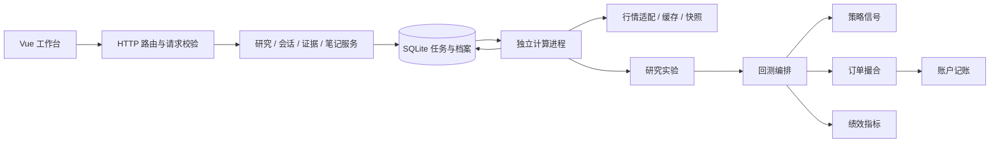

# 架构与扩展约定

QuantSandbox 采用模块化单体：一个本地 API 服务、一个前端工作台和串行计算进程。模块通过明确的输入与结果协作，保留独立测试能力。

## 请求与计算

`main.py` 只装配服务、管理启动关闭并映射错误。`api/routes` 声明路径、状态码和响应模型；业务校验在 `services/research.py` 等服务中完成。服务通过 `ResearchError` 表达可预期失败，由 API 转成 HTTP 响应。

`JobRunner` 管理进程、进度、取消和中断恢复。实验函数接收数据与配置，不承担 HTTP 生命周期；参数实验通过可选进度回调通知运行器。

## 内核边界

| 模块 | 职责 |
| --- | --- |
| `core/engine.py` | 交易日推进、订单队列、策略切换、分支重放与审计记录 |
| `core/strategy.py` | 因果指标与持有信号 |
| `core/strategy_catalog.py` | 策略标识、参数别名、默认值与表单元数据 |
| `core/execution.py` | 开盘撮合、停牌/涨跌停、T+1、整手和预算 |
| `core/account.py` | 现金、持仓数量、成本与已实现盈亏 |
| `core/metrics.py` | 从账户序列与成交计算绩效 |
| `core/providers.py` | 外部行情请求与字段、单位规范化 |
| `core/data_center.py` | 行情缓存与数据访问编排 |
| `core/data_format.py` | 数据校验、规范序列化、哈希与原子文件写入 |
| `core/snapshots.py` | 内容寻址的 Parquet 快照及清单 |

旧 `run_backtest`、`BacktestEngine`、`calculate_metrics` 和 `DataCenter` 入口继续可用。账户和撮合在内部使用未舍入金额，结果记录保持既有精度。结构改动必须保持相同输入的账本、指标和分支前缀一致。

## 契约与持久化

请求模型与响应模型分别维护。`Run` 按 `kind` 区分普通回测、分叉、压力、参数和滚动样本外结果；未完成任务允许 `result=null`。`RunSummary` 仅表示列表摘要，避免把实验结果声明成带有行情和成交的普通回测。

响应模型保留扩展审计字段。证据包直接从已保存结果构造，保留数值与完整性校验口径；普通接口的类型处理不得改变证据重放的输入。

SQLite 保存任务元数据、结果、笔记和会话。列表查询只提取结果中的摘要指标，不将全部行情、成交和检查点传入 Python。快照通过内容指纹定位；配置、快照和执行时实现指纹组成研究的复现依据。

本次结构调整沿用既有表结构和证据格式。后续变更持久化字段时，应提供显式迁移、旧数据回归样例及失败恢复策略。产品名称统一为 QuantSandbox；内部兼容性标识继续用于读取和核对历史数据。

## 前端生命周期

`workspace/store.ts` 提供页面使用的稳定入口，状态、通知、轮询和盲测请求分模块管理。同一任务复用轮询；切换选择或销毁工作区时，过时请求不得覆盖新选择。空档案由用户显式创建示例或回测。

新增页面优先使用类型收窄读取对应结果，复用已有图表、账本和表单组件。HTTP 请求统一处理超时和取消；业务取消与停止浏览器轮询是不同操作。

## 扩展检查

- 新策略：补目录元数据、请求校验、信号实现及前缀因果性测试。
- 新数据来源：实现提供器协议并规范 OHLCV、日期和成交量单位；明确价格口径和错误来源。
- 新撮合规则：先定义生效时点和现金/持仓影响，再增加账户守恒、延迟执行及重放测试。
- 新实验：复用内核，定义独立结果契约，并验证训练与测试数据边界。
- 性能改动：先用固定输入测量，再检查结果一致性；检查点恢复需完整持久化状态后另行设计。
