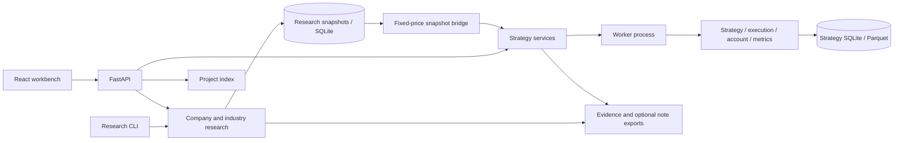

# Architecture and extension boundaries

QuantSandbox is a modular monolith: a React browser interface, a FastAPI service, local SQLite/Parquet stores, and separate strategy worker processes. Browser, CLI and API entry points reuse the same Python research and calculation modules.

## Application and service lifecycle

`backend/main.py` assembles routers, middleware, error mapping, services and the optional built frontend. `create_app(root)` gives tests an isolated data root. The research request scope uses a ContextVar and is propagated to explicit background fetching tasks. Production research data defaults to `data/workbench`.

`backend/api/routes` owns HTTP paths, request/response validation and status codes. Domain validation belongs in services. Expected strategy failures use `ResearchError`; provider failures remain visible. `JobRunner` manages calculation processes, progress, cancellation and interrupted-job recovery. Experiment functions receive inputs and configuration independently of HTTP lifetimes.

The server binds localhost. Public data fetching is explicit; the application has no brokerage, account-trading or live-order integration.

## Research, projects and immutable inputs

`backend/workbench` contains financial statements, company profiles, industry observations, statistics, ETF flows and disclosed institutional evidence. Its routes use `/api/research/*`; `python -m backend.workbench.cli` exposes the same module logic.

`backend/services/projects.py` stores questions, securities, conclusions and typed record links. Projects reference saved results rather than copying them. Strategy runs and research analyses retain independent IDs and payloads.

`/api/bridge/backtests` accepts specific frozen, unadjusted quote snapshots. It checks provenance, volume units, price basis and interval coverage before scheduling; available earlier history provides indicator warm-up, and future bars are truncated. It never downloads replacement prices. Subsequent experiments reuse the fixed strategy snapshot even if research caches change.

## Calculation core

| Module under `backend/core` | Responsibility |
| --- | --- |
| `engine.py` | Trading-day progression, pending orders, strategy switches, forks and audit records |
| `strategy.py` | Causal indicators and position signals |
| `strategy_catalog.py` | Strategy IDs, aliases, defaults and parameter metadata |
| `execution.py` | Open-price matching, suspension/price limits, T+1, lots and budgets |
| `account.py` | Cash, quantity, cost basis and realized profit/loss |
| `metrics.py` | Performance from account paths and trades |
| `providers.py` | Public providers, field normalization and units |
| `data_center.py` | Provider/cache orchestration and snapshot access |
| `data_format.py` | Validation, canonical serialization, hashing and atomic writes |
| `snapshots.py` | Content-addressed Parquet snapshots and manifests |

Keep compatibility entry points such as `run_backtest`, `BacktestEngine`, `calculate_metrics` and `DataCenter`. Internal accounting uses unrounded amounts; presentation preserves the documented result precision. A structural change must preserve ledger entries, metrics and fork prefixes for the same fixed inputs.

Daily signals execute no earlier than the next tradable open. Optional `is_suspended`, `limit_up` and `limit_down` values survive normalization, caching, export and replay and participate in hashes. Unknown controls remain unknown. OHLCV-only snapshots retain their earlier hash representation.

## Persistence and evidence

Strategy SQLite stores tasks, results, notes and replay sessions; Parquet stores frozen daily bars. List queries read summary fields without loading every bar, trade and checkpoint. Research SQLite stores immutable input payloads, analysis records and local company profiles. Project storage links these records without merging their schemas.

The configuration, input snapshots and execution-time implementation fingerprint form the reproduction evidence. Evidence export uses stored results and fingerprints. Import verifies original package integrity before recomputation. Upload the original JSON text; browser parse/stringify can change the numeric representation and invalidate the evidence checksum. SHA256 checks content integrity, not publisher authenticity.

Schema changes need explicit migration behavior, existing-record regression cases and a failure recovery plan. Do not reinterpret archived research as a newly computed result.

## React state and asynchronous work

- `frontend/src/App.tsx` groups navigation and lazy-loads feature pages.
- `workspace/ProjectContext.tsx` owns project selection, deep links, record association and protection against late selection responses. There is no Vue store in the current runtime.
- `pages` contains company, data, market-observation, statistics, archives and note pages.
- `simulation/useSimulationData.ts` separates list requests from selected-record requests. `simulation/usePlayback.ts` manages replay selection, cursor and blind sessions; `Terminal`, `Composer`, `Comparison` and `Results` compose the strategy page.
- `http.ts` provides shared strategy/project transport, timeouts and cancellation. `api.ts` wraps the research API. Cancelling browser polling and cancelling a server task are distinct actions.
- `i18n.ts` and `i18n/*` translate interface copy. `theme.ts`, `themes.css` and component styles handle appearance. Preferences use small local browser-storage keys. Switching language or theme preserves selected records and unsaved fields.
- `chart-export.ts` freezes inherited theme tokens into standalone SVG exports without changing the rendered chart or research data.

Capture the originating project when starting asynchronous work. A later project switch must not attach old responses or newly completed records to the new project. Cancelling or invalidating a request must prevent it from restoring obsolete state. Notes preview tokens become stale when their inputs change.

## Optional notebook integration

`backend/integrations/obsidian.py` produces portable Markdown, SVG and relative-path attachments. Export requires no vault configuration. Direct writing requires an explicit previewed operation and creates new files only; it refuses overwrite, traversal and unsafe targets. It does not read or scan notebook contents. Local settings never enter shareable exports or source releases.

## Extension checks

Add strategy catalog metadata, validation, causal-prefix tests and execution cases for a new strategy. A provider needs normalized dates/OHLCV/volume units, price-basis metadata and explicit error behavior. Execution changes require timing, accounting conservation and evidence replay checks. Experiments need separate result contracts and training/test boundaries. Measure performance with fixed inputs before changing storage or checkpoint restoration.

Use [the API contract](API_CONTRACT.md), [contribution guide](../CONTRIBUTING.md), [offline reproduction](reproducibility.md) and [release process](releases.md) as concrete entry points.
