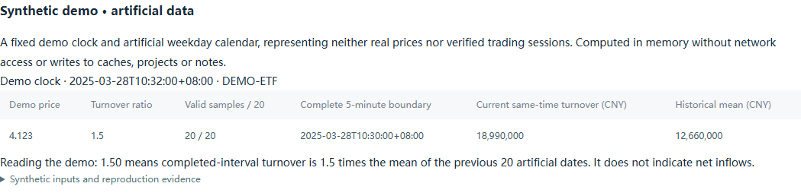

# First run with QuantSandbox

[简体中文](getting-started.zh-CN.md) · [Installation](../README.md#quick-start)

Install with `setup.cmd`, then run `start.cmd` and open http://127.0.0.1:8766. Later starts reuse the installed environment. The service listens locally. Select English/中文 and Appearance in the top bar.

## Explore without market data

On the **Projects** home page, choose **Open offline strategy demo**:

1. Read the question and run the baseline (5-day and 20-day moving averages).
2. Check the evaluation period, sample count, modeled costs, and buy-and-hold benchmark. The strategy uses a daily close signal and can fill no earlier than a later eligible open.
3. Change the windows and run a comparison on the same synthetic snapshot. Inspect the results and replay the selected run's evidence in a fresh temporary store.

The browser demo uses the same fixed fixture as the offline CLI example below. It calls only the local service for calculation and does not add runs to your projects or archives. The demonstration shows how to compare and reproduce a calculation; a result on synthetic prices is not evidence of a market edge.

## Try the separate ETF observation demo

Open ETF flows and choose **View synthetic demo**. The example uses hand-authored inputs, a fixed clock, and an artificial weekday calendar. It makes no network requests and does not read or write your research store. It is separate from the live dashboard.

You can inspect the same example without starting the service:

```powershell
.\.venv\Scripts\python.exe -X utf8 -m backend.workbench.cli etf-intraday-demo
```

With the service running, `GET /api/research/etf/intraday-demo` returns the same calculation. Expect `synthetic: true`, code `DEMO-ETF`, source `synthetic:hand-authored-v1`, a fixed 2025-03-28 10:32 Shanghai clock, a 10:30 comparison boundary, 20 eligible reference days, ratio 1.5, and an input SHA-256. The artificial calendar demonstrates computation, not exchange-calendar or live-feed verification.

For a separate offline backtest and evidence round trip, run:

```powershell
.\.venv\Scripts\python.exe -X utf8 scripts/reproduce.py
```

## Choose the right refresh



| Control | What it updates | Timing |
| --- | --- | --- |
| Refresh lightweight quotes | Tencent batch prices and cumulative volume/amount | Reuses a 20-second server cache |
| Automatic quote polling | The same lightweight quotes while the page is visible and the trading session is eligible | Every 20 seconds; pauses at lunch, after close and when hidden |
| Update historical baseline | Eastmoney five-minute bars used for same-time comparisons | Separate job; existing minute caches have a five-minute TTL |
| Daily Refresh now / schedule | ETF shares, NAVs and daily flow research | Default 15:30 Asia/Shanghai; separately configurable |

**The daily schedule is enabled on first start.** It runs only while this workspace's service is running. Change its time or disable it in ETF settings before the next scheduled refresh if you prefer manual acquisition. It is independent of quote polling, and it never publishes notes. A daily refresh also starts a separate historical-baseline warm-up after saving its daily result. First-time live intraday comparisons need quotes and minute history; inspect both job results. With automatic polling enabled, a stale overnight or missing quote is retried every five minutes during weekday session windows. Weekday windows alone do not establish that an exchange is open.

## Read an observation

Check the provider date/time, acquisition time, source, units, snapshot, sample count and gaps before reading a ratio. Prices preserve the provider's reported decimal precision; for example, the synthetic ETF price is 4.123. Tencent turnover uses its precise amount component in CNY; its rounded CNY10,000 field is a cross-check. Eastmoney turnover uses reported bar amounts. Same-time ratios divide Eastmoney current-day cumulative completed bars by Eastmoney historical amounts at that boundary. Tencent cumulative totals remain separate because source aggregations differ.

At 10:43, the boundary is 10:40. A full reference day has all 48 regular five-minute bars. The previous 20 calendar sessions are considered without replacing missing sessions with older ones. Five eligible days permit a provisional ratio; full status needs 20 and covered calendar dates. Missing inputs stay missing, a zero denominator produces no ratio, and failures retain old snapshots with errors and their original dates. A failed refresh never makes old data fresh. See [intraday methodology](etf-intraday.md) for source precision and stale rules.

## Save a first research project

1. Create a project from the home page and select the securities and research question. Use the company template and peers appropriate to the business.
2. Reuse a fixed snapshot or explicitly fetch/import public inputs. Check coverage, units, reporting dates and known availability dates.
3. Save an analysis or experiment to that project. Strategy bridging uses the selected unadjusted-price snapshot.
4. Save the project's conclusion locally, then export the evidence you want to share. Obsidian is optional; downloads require no vault configuration.

Current provider data and revised financials are not a historical point-in-time archive. ETF turnover, subscriptions/redemptions and margin observations do not identify a trading institution. State-backed holdings require original entity disclosure evidence.

If a provider fails, read the job error and keep its prior snapshot date visible. An empty response does not establish the absence of announcements. Inspect cached status with `python -m backend.workbench.cli status`; API documentation is at `/docs`.

If a damaged-settings warning appears, automatic daily fetching is paused. **Save time** can repair the settings without changing the time or enabling fetching; switch it back on separately when desired. Interrupted downloads require an explicit refresh and can reuse completed caches.
