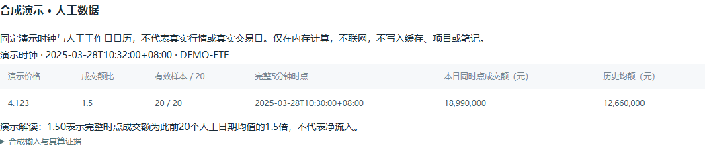

# QuantSandbox 上手指南

[English](getting-started.md) · [安装](../README.zh-CN.md#打开与安装)

出现“刷新设置损坏”提示时，自动日频取数会暂停。可点击**保存时间**修复设置，无需改变时间，也不会自动开启取数；需要时再单独打开开关。中断的下载可手动重新刷新，并复用已完成缓存。

先运行 `setup.cmd`，再运行 `start.cmd`，打开 http://127.0.0.1:8766。之后启动会复用已安装环境。服务只监听本机；顶部可选择 English/中文和主题。

## 不取行情，先看演示

在**研究项目**首页选择**打开离线策略演示**：

1. 阅读研究问题，运行 5 日／20 日均线基准策略。
2. 检查评估区间、样本量、费用设定及买入持有对照。策略用日线收盘生成信号，最早在之后符合条件的开盘成交。
3. 改动均线窗口，在同一份合成快照上运行对照，再选择一组结果重放证据。重放在另一份临时存储内重新计算。

界面使用与下方离线 CLI 示例相同的固定样本。演示只请求本机服务，结果不进入项目和真实档案。人工行情用于展示如何比较和复算，不能说明策略在市场中有效。

## 单独体验 ETF 盘中观察

进入 ETF 页面，点击**查看合成演示**。示例使用人工输入、固定时钟和人工工作日日历，不联网，也不读写本机研究存储，与真实看板分开展示。

无需启动服务也能运行相同计算：

```powershell
.\.venv\Scripts\python.exe -X utf8 -m backend.workbench.cli etf-intraday-demo
```

服务运行时，可访问 `GET /api/research/etf/intraday-demo`。预期包含 `synthetic: true`、代码 `DEMO-ETF`、来源 `synthetic:hand-authored-v1`、固定北京时间 2025-03-28 10:32、10:30 比较截止点、20 个有效历史样本、比值 1.5 和输入 SHA-256。人工日历用于说明计算，不代表交易所日历核验或真实行情实测。

还可独立运行离线回测与证据往返验证：

```powershell
.\.venv\Scripts\python.exe -X utf8 scripts/reproduce.py
```

## 选对刷新按钮



| 控件 | 更新内容 | 节奏 |
| --- | --- | --- |
| 刷新轻量报价 | 腾讯批量价格与累计量额 | 复用 20 秒服务端缓存 |
| 自动报价轮询 | 页面可见且处于符合条件的交易时段时，更新同一轻量报价 | 每 20 秒；午休、收盘后、页面隐藏时暂停 |
| 更新历史基准 | 同时点比较所需的东方财富 5 分钟线 | 独立任务；已有分钟缓存的 TTL 为 5 分钟 |
| 日频立即刷新／定时设置 | ETF 份额、净值与日频资金观察 | 默认北京时间每日 15:30，可单独修改 |

**首次启动默认开启每日定时刷新。** 只有本工作区服务运行时才执行。希望手动取数时，可在下一次计划时间前于 ETF 设置中关闭；也可修改执行时间。日频计划与报价轮询独立，不自动发布笔记。日频结果保存后，还会启动独立历史基准预热任务。首次查看真实盘中比较，需要报价和分钟历史两类输入，分别检查任务结果。开启自动轮询后，隔夜旧报价或空报价会在工作日时段窗口内每 5 分钟重试；仅凭工作日窗口不能证明交易所实际开市。

## 读懂观察值

先看来源日期／时间、获取时间、来源、单位、快照、有效样本和缺口，再看比值。价格保留来源报告的小数精度，例如合成 ETF 价格为 4.123。腾讯成交额使用精确金额分量，统一为元；万元舍入字段仅作交叉检查。东方财富使用其报告的分钟成交额。同时点比值由东方财富当日完整分钟线累计额除以同源历史同时点均值；腾讯累计成交额独立展示，两源聚合存在差异。

10:43 报价对应最近完成的 10:40 比较点。完整历史日须具备 48 根常规 5 分钟线。只考察此前 20 个日历交易日，缺失日不以更早日期补足。至少 5 日可提供临时参考，20 日且日历覆盖完整才为完整状态。缺失保持缺失，分母为零时不输出比值；失败保留旧快照、原日期和错误，不能让旧数据变新鲜。精度与陈旧规则见[盘中方法说明](etf-intraday.zh-CN.md)。

## 保存第一个研究项目

1. 在首页创建项目，选择证券与研究问题，按业务选择公司模板与同行。
2. 复用固定快照或明确获取／导入公开输入，检查覆盖、单位、报告期与已知公布时间。
3. 将分析或实验保存到当前项目；策略桥接引用选定的未复权行情快照。
4. 保存项目结论到本工作区，再选择导出证据。Obsidian 为可选项，下载无需配置笔记库。

当前来源数据与修订财报不构成历史 point-in-time 档案。ETF 成交额、申赎与融资不能识别具体交易机构；国家队持仓需要原文实体披露证据。

上游失败时查看任务错误，保留旧快照日期；空返回不证明没有公告。缓存状态可用 `python -m backend.workbench.cli status` 查询，运行中的 API 文档在 `/docs`。
